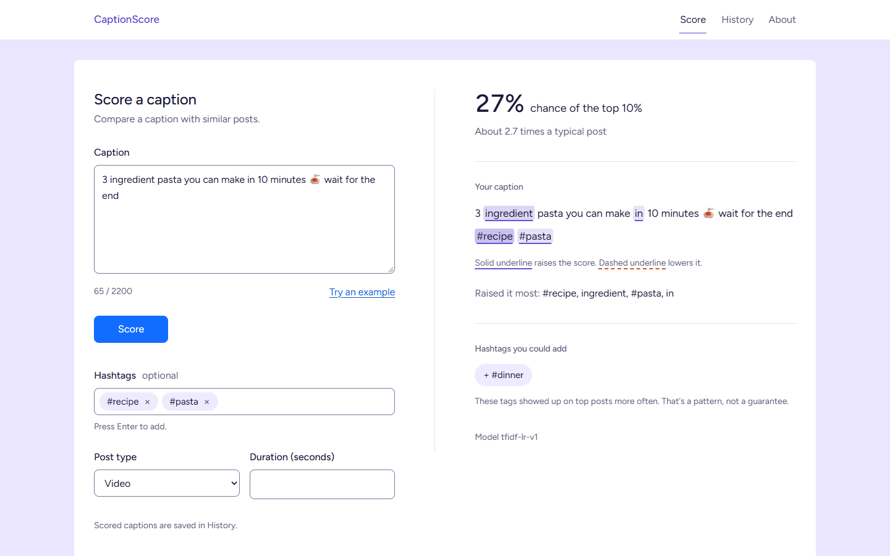
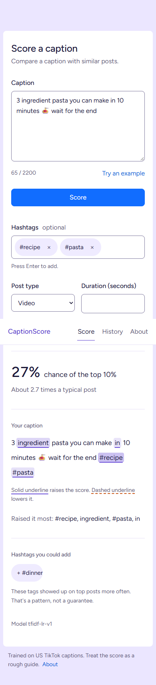
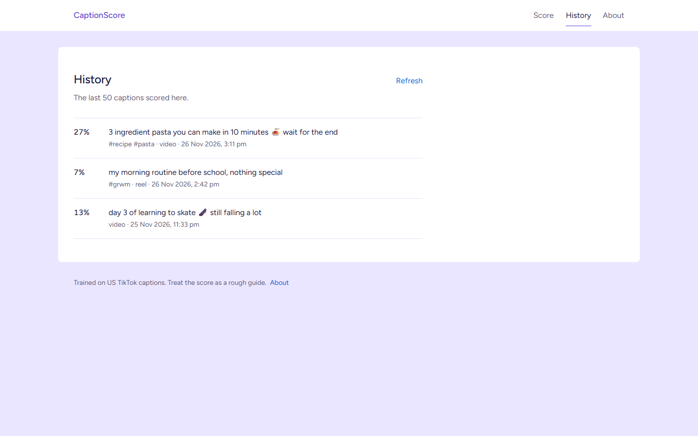

# CaptionScore

CaptionScore reads the caption of a short video and estimates the chance that the post lands in
the **top 10% of comparable posts by views**. It marks the words that pushed the score up or down
and suggests related hashtags. It is a text-classification project (Python, scikit-learn) served
through a small MERN web app (MongoDB, Express, React, Node) with a FastAPI model service.



| Phone | History |
|---|---|
|  |  |

More: [empty form](docs/screenshots/score-empty-1440-light.png),
[error](docs/screenshots/score-error-1440-light.png)
and [About](docs/screenshots/about-1440-light.png).

## Contents
- [The problem](#the-problem)
- [Data and license](#data-and-license)
- [Label definition](#label-definition)
- [Results](#results)
- [How it works](#how-it-works)
- [How to run](#how-to-run)
- [Configuration](#configuration)
- [Tests](#tests)
- [Limitations](#limitations)
- [Ethics](#ethics)
- [Deployment notes](#deployment-notes)
- [Repository layout](#repository-layout)

## The problem
Creators often wonder whether a caption helps a post. Most of what makes a video do well is not in
the caption: the video itself, timing and, above all, the size of the creator's audience. The
question here is narrower and honest about that: **given only the caption text, can a model rank
posts better than chance at reaching the top 10% of comparable posts?** The answer is yes, but the
signal is small (see [Results](#results)).

## Data and license
- **Source:** Hugging Face [`datasocial/tiktok-5.6B-videos`](https://huggingface.co/datasets/datasocial/tiktok-5.6B-videos),
  about 5.6 billion rows of TikTok video metadata (captions, hashtags, view counts, timestamps),
  not videos.
- **License:** CC BY-NC 4.0, non-commercial use only. This project is non-commercial, and no data
  is included in this repository (`ml/data/` is gitignored).
- **Sample:** the dataset is about 460 GB, so it is never downloaded in full. Each monthly Parquet
  file is sorted by country and time, so "the first N rows" would be badly biased. Instead, two
  random row groups per month are read over HTTP range requests (4.95 GB streamed, not stored),
  then mixed-country row groups are swapped for US-only ones (0.75 GB). Result: **840,000 US,
  English videos, exactly 15,000 per month from January 2022 to August 2026**. Paid ads are then
  removed (1.34%), leaving 828,742 posts.
- **No creator or follower column exists**, which is the main limitation (see
  [Limitations](#limitations)).

Full details, schema, null rates and the sampling design: [docs/data_notes.md](docs/data_notes.md).

## Label definition
A video is **top 10%** if its views are in the top 10% of videos posted in the **same calendar
month** and captured at a **similar age** (the same third of that month by age at capture).

- Comparing within a month stops older videos, which had longer to collect views, from dominating.
- The age-at-capture split matters: with month-only labels, videos whose stats were captured
  soonest after posting were labelled top 10% 13.2% of the time and those captured latest only
  5.8%, which reflects how the data was collected, not the caption.
- Videos younger than 30 days at capture, with zero views, with empty captions, or marked as ads
  are dropped. The threshold is a config value; 5% and 20% are reported below.
- **Splits are by time, never shuffled:** train 2022-01 to 2025-08 (656,136 posts), validation
  2025-09 to 2026-04 (114,813), test 2026-05 to 2026-07 (44,104), and a separate "stress" month,
  2026-08 (13,689), whose view levels looked unusual.

Evidence and weaknesses: [docs/label_notes.md](docs/label_notes.md).

## Results
Chance level for PR-AUC is the share of positives, about **0.10**. Every number below is generated
from [`ml/reports/metrics.json`](ml/reports/metrics.json) by `python -m src.readme_results`, and a
test fails if the two ever disagree.

<!-- results:start -->
### Validation (Sep 2025 to Apr 2026, 114,813 posts, 10.01% positive)

| Model | PR-AUC | PR-AUC, near-duplicates removed | ROC-AUC | F1 | Precision in top 10% |
|---|---|---|---|---|---|
| Majority class (constant score) | 0.1001 | 0.1014 | 0.5000 | 0.1820 | 0.1038 |
| Random scores | 0.0995 | 0.1008 | 0.4995 | 0.1821 | 0.0991 |
| Meta features only, LightGBM | 0.1505 | 0.1512 | 0.6201 | 0.2232 | 0.1845 |
| **TF-IDF word + char n-grams, logistic regression (app model)** | 0.1803 | 0.1818 | 0.6698 | 0.2591 | 0.2220 |
| TF-IDF + meta features, LightGBM | 0.1845 | 0.1857 | 0.6705 | 0.2607 | 0.2274 |
| MiniLM sentence embeddings, logistic regression | 0.1561 | 0.1570 | 0.6328 | 0.2316 | 0.1875 |
| MiniLM embeddings + meta features, LightGBM | 0.1742 | 0.1751 | 0.6603 | 0.2505 | 0.2125 |
| DistilBERT fine-tuned (~250k-row subset of train) | 0.1777 | 0.1786 | 0.6646 | 0.2544 | 0.2168 |

F1 uses the threshold that maximises F1 on validation (0.1274 for the app model); the same threshold is reused unchanged on test.

**Model choice.** The best validation PR-AUC was TF-IDF + meta features in LightGBM, +0.0042 above TF-IDF + logistic regression. A paired bootstrap over 22 posting days gives a 95% interval of [-0.0009, +0.0089], which includes 0, so the simpler model was chosen: it is within noise and gives exact per-word explanations. DistilBERT was run afterwards as an extra experiment and never evaluated on test.

### Test (May to Jul 2026, evaluated once) and stress month (Aug 2026)

| Split | Posts | Positive rate | PR-AUC | PR-AUC, near-duplicates removed | ROC-AUC | F1 | Precision in top 10% | Majority PR-AUC | Random PR-AUC |
|---|---|---|---|---|---|---|---|---|---|
| Test | 44,104 | 0.1001 | 0.1863 | 0.1873 | 0.6753 | 0.2613 | 0.2299 | 0.1001 | 0.1023 |
| Stress (Aug 2026) | 13,689 | 0.1002 | 0.1724 | 0.1727 | 0.6635 | 0.2468 | 0.2126 | 0.1002 | 0.0998 |

### Label threshold sensitivity (validation, `tfidf_meta_lgbm`)

| Label | Positive rate | PR-AUC | PR-AUC / chance | ROC-AUC |
|---|---|---|---|---|
| Top 5% | 0.0501 | 0.1052 | 2.10 | 0.6858 |
| Top 10% | 0.1001 | 0.1845 | 1.84 | 0.6705 |
| Top 20% | 0.2002 | 0.3220 | 1.61 | 0.6628 |

**Leakage checks.** Retraining on shuffled labels gives validation PR-AUC 0.1012, 0.1022, 0.0995, 0.1012 (chance is 0.10). Removing validation captions that have a near-duplicate in train changes PR-AUC by about +0.001.
<!-- results:end -->

**In plain terms:** of the captions the app model ranks in its top 10%, about 22% really were top
10%, against 10% for a random post. The model's probabilities are well calibrated: across
validation deciles, predicted and actual rates match closely (top decile 0.241 predicted vs 0.222
actual). Per-month validation PR-AUC stays between 0.167 and 0.200, so the result does not
depend on a few months.

Charts: [validation PR-AUC by month](ml/reports/val_per_month_pr_auc.png) and
[precision-recall curves](ml/reports/val_pr_curves.png). Word and hashtag tables:
[ml/reports/explainability.md](ml/reports/explainability.md).

## How it works
```
React (Vite)  ──>  Express API  ──>  FastAPI model service  ──>  TF-IDF + logistic regression
frontend/          backend/          model-service/              (ml/models/final, built by ml/)
                      │
                      └──>  MongoDB (predictions collection)
```
- **Model:** TF-IDF on word 1-2 grams and character 3-5 grams of the cleaned caption (lowercased,
  URLs and mentions replaced, emojis turned into names like `:fire:`), then logistic regression.
- **Explanations:** the model is linear, so each word's contribution to the score is exact. Word
  and character features are assigned to the words they came from, and the contributions add up
  to the model's log-odds (tested).
- **Hashtag suggestions:** 486 hashtags appear in at least 500 training posts; 175 of them reach
  the top 10% reliably more often than average (95% Wilson interval above the base rate). For a
  caption, the service picks related ones and keeps only those that raise its score.
- **Model service (FastAPI):** loads the model once at startup; `POST /predict`, `GET /health`,
  `GET /model-info`. Pydantic validates input (caption up to 2,200 characters, up to 30 hashtags).
- **Backend (Express):** validates input with zod, rate-limits, restricts CORS, calls the model
  service, saves each prediction to MongoDB and returns it; `GET /api/history` lists recent ones.
  If the model service is down it returns a clear 503 and saves nothing.
- **Frontend (React):** Score, History and About pages in a light purple and white theme. The
  result is split into three quiet groups: the score, your caption with the words that moved it
  marked, and hashtag suggestions. Colours are checked for WCAG AA contrast by a test, and touch
  targets are at least 44px on phones.

## How to run
### Web app (three terminals, no Docker needed)
Prerequisites: Python 3.11+, Node 20+, a MongoDB connection string (the MongoDB Atlas free tier
works), and the trained model in `ml/models/final/` (gitignored; build it with the ML pipeline
below).

Create a `.env` file at the repo root with at least `MONGODB_URI` (see
[Configuration](#configuration)). The other settings default to the ports below.

```bash
# Terminal 1: model service (FastAPI) -> http://localhost:8000
cd model-service
python -m venv .venv
.venv/Scripts/pip install -r requirements.txt          # macOS/Linux: .venv/bin/pip
.venv/Scripts/pip install --no-deps -e ../ml
.venv/Scripts/uvicorn app.main:app --port 8000

# Terminal 2: backend (Express + MongoDB) -> http://localhost:4000
cd backend
npm install
npm run dev

# Terminal 3: frontend (React + Vite) -> http://localhost:5173
cd frontend
npm install
npm run dev
```
Open http://localhost:5173. http://localhost:4000/api/health reports whether MongoDB and the
model service are reachable.

### ML pipeline (Python)
```bash
cd ml
python -m venv .venv
.venv/Scripts/activate        # macOS/Linux: source .venv/bin/activate
pip install -r requirements.txt
python -m src.inspect_schema            # schema + 5 example rows (streaming)
python -m src.sample_data --dry-run     # reads only Parquet footers, prints the download size
python -m src.sample_data --confirm     # time-spread sample into ml/data/ (~4.95 GB streamed)
python -m src.describe_sample           # numbers for docs/data_notes.md
python -m src.resample_us --confirm     # replace mixed-country row groups with US-only ones (~0.75 GB)
python -m src.analyze_labels            # evidence for the label definition
python -m src.build_dataset             # labels, time splits, features -> ml/data/dataset.parquet
python -m src.dedup_check               # exact / near-duplicate captions across splits
python -m src.train_baselines           # baselines on validation -> reports/metrics.json
python -m src.embed --splits train val  # MiniLM caption embeddings (~60 min on CPU, resumable)
python -m src.train_embeddings          # classifiers on embeddings
python -m src.export_colab              # data for fine-tuning DistilBERT on Colab
#   run ml/notebooks/finetune_distilbert_colab.ipynb on a Colab T4 GPU, then:
python -m src.import_transformer_preds  # score the DistilBERT predictions
python -m src.plot_baselines            # reports/val_per_month_pr_auc.png
python -m src.select_model              # model choice on validation (+ bootstrap, PR curves)
python -m src.evaluate_test             # one-time test + stress evaluation (refuses to run twice)
python -m src.build_explainability      # explanations, hashtag lift, exports ml/models/final/
python -m src.readme_results            # regenerate the README results tables
```

## Configuration
All settings are environment variables, read from a `.env` file at the repo root in
development. Never commit `.env`.

| Variable | Used by | Default | Notes |
|---|---|---|---|
| `MONGODB_URI` | backend | (required) | MongoDB connection string, for example from MongoDB Atlas |
| `MONGODB_DB` | backend | `captionscore` | Database name |
| `PORT` | backend | `4000` | |
| `MODEL_SERVICE_URL` | backend | `http://localhost:8000` | |
| `MODEL_SERVICE_TIMEOUT_MS` | backend | `5000` | |
| `CORS_ORIGIN` | backend | `http://localhost:5173` | Comma-separated list of allowed origins |
| `RATE_LIMIT_PER_MINUTE` | backend | `30` | Per client, for `POST /api/predict` |
| `VITE_API_URL` | frontend (build time) | `http://localhost:4000` | |
| `MODEL_DIR` | model service | `ml/models/final` | Folder with `model.joblib`, `suggest.joblib`, `model_card.json` |
| `HF_TOKEN` | ML sampling | none | Optional; only raises Hugging Face rate limits |

### Docker
`docker-compose.yml` and a Dockerfile per service are included but **not tested yet**. The
three-terminal setup above is the supported way to run the app.

## Tests
| Area | Command | What it covers |
|---|---|---|
| ML | `cd ml && pytest` | cleaning rules, labels, time splits, features, metrics, explanations that add up exactly, README results matching `metrics.json` |
| Model service | `cd model-service && .venv/Scripts/python -m pytest` | `/predict` contract, input validation and length cap, `/health`, startup without a model |
| Backend | `cd backend && npm test` | zod validation, saving to MongoDB (in-memory server), model service down or slow, rate limiting, CORS, history |
| Frontend | `cd frontend && npm test` | form behaviour, result wording, error states, History, About, WCAG contrast of every colour pair |

Lint: `ruff check` in `ml/` and `model-service/`; `npm run lint` in `backend/` and `frontend/`.

## Limitations
- **Creator size is not observed.** A big account's average post beats a small account's best
  one, and the data has no follower counts. Captions can only explain a small part of reach.
- **The label is relative.** "Top 10%" is within a month and capture age, not a number of views.
  The view count needed to be top 10% ranges from about 1,300 to 23,000 depending on the month.
- **TikTok, US, English only.** Using it for Instagram or other markets is untested. Posts whose
  language was marked "undetermined" were dropped, even though many are English.
- **Few posting days per month.** Each sampled month covers 2 to 5 posting days, so posting time
  and day of week are not used as features.
- **The newest month behaves differently.** 2026-08 had higher view levels even at the same age,
  so it is reported separately; the model scores a little lower there (see Results).
- **Associations, not causes.** Words and hashtags that score well were linked to top posts in
  the past. Adding them does not guarantee anything.
- **v1 app limits:** no accounts, so History is shared by everyone using the site; the rate limit
  is in memory and resets when the backend restarts; the Docker setup is untested.

## Ethics
- The dataset's own card says it was collected through TikTok's private mobile API, which goes
  against TikTok's terms of service. Because of that, **the app never displays captions from the
  dataset**, the repository contains no data, and the published reports only show aggregates
  (words and hashtags seen in at least 500 posts).
- The data is licensed for non-commercial use only, and this project is non-commercial.
- Captions typed into the app are stored so they can appear in History. No account, IP address or
  other personal data is stored, and the Score page says that scored captions are saved.
- The model rewards whatever was popular in its training period. It should be read as a rough,
  backward-looking signal, not advice on what people should post.

## Deployment notes
The app has three deployable parts plus a database:

| Part | Suggested host | Settings |
|---|---|---|
| Database | MongoDB Atlas (free tier) | Allow the backend's outbound IP in Network Access. |
| Model service | Any Python web host (Render, Railway, Fly.io) | Ship `ml/models/final/` with the service (for example as a GitHub Release asset downloaded at build time) and set `MODEL_DIR`. Keep it private to the backend if the host allows. |
| Backend | Any Node host | `MONGODB_URI`, `MONGODB_DB`, `MODEL_SERVICE_URL`, `CORS_ORIGIN` (the frontend's URL), `RATE_LIMIT_PER_MINUTE`, `PORT`. |
| Frontend | Any static host (Vercel, Netlify, Cloudflare Pages) | Build with `VITE_API_URL` set to the backend URL; route unknown paths to `index.html`. |

The model service pins scikit-learn 1.9.1, the version the model was saved with; a different
version may not load it. Secrets belong in each host's environment settings, never in the repo.

## Repository layout
```
ml/             data sampling, labels, features, training, evaluation, explanations
  src/          one module per step (see the ML pipeline commands above)
  reports/      metrics.json, comparison tables, charts, hashtag lift
  notebooks/    Colab notebook for the DistilBERT experiment
model-service/  FastAPI service that loads the trained model
backend/        Express API with MongoDB (Mongoose)
frontend/       React (Vite) web app
docs/           data notes, label notes, screenshots
```
